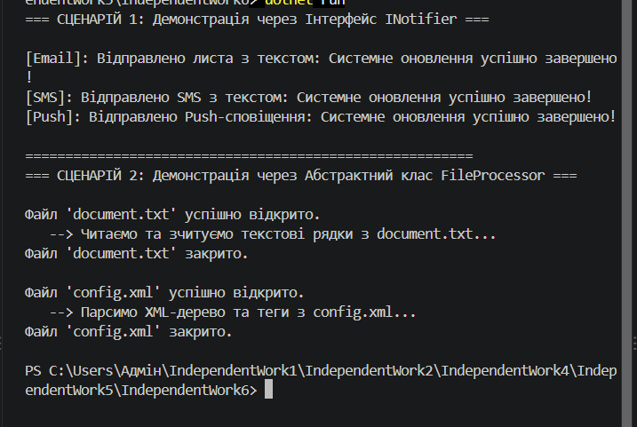

  Сценарій 1: Система сповіщень

 Обраний підхід: Інтерфейс (`INotifier`)

 Обґрунтування вибору:
У даному сценарії використання інтерфейсу є найбільш доцільним архітектурним рішенням з наступних причин[cite: 21]:
1 Відсутність спільного стану або коду: `EmailNotifier`, `SmsNotifier` та `PushNotifier` не мають спільних полів чи однакової внутрішньої логіки відправки. Все, що їх об'єднує — це контракт методу `Send(string message)`[cite: 20].
2 Підтримка множинного наслідування поведінки: У C# класи можуть реалізовувати декілька інтерфейсів. Наприклад, `EmailNotifier` може одночасно реалізовувати `INotifier` та `IDisposable` або `ILogger`.
3 Слабке зв'язування (Loose Coupling): Клієнтському коду достатньо знати тільки про інтерфейс `INotifier`, що дозволяє легко додавати нові канали сповіщень (наприклад, `TelegramNotifier`) без зміни наявної логіки[cite: 21].

Чому абстрактний клас менш доречний:
Створення абстрактного класу `BaseNotifier` штучно прив'язало б усі класи до єдиної ієрархії наслідування та позбавило б їх можливості успадковувати інші класи[cite: 21].

---

  Сценарій 2: Обробка файлів

 Обраний підхід: Абстрактний клас (`FileProcessor`)

 Обґрунтування вибору:
У цьому сценарії використання абстрактного класу є суттєво вигіднішим[cite: 21]:
1 Повторне використання коду (DRY): Методи `OpenFile()` та `CloseFile()` містять однакову логіку для всіх типів файлів. Винесення цієї логіки в базовий абстрактний клас позбавляє від дублювання коду в кожному конкретному процесорі[cite: 20].
2 Спільний стан: Базовий клас містить властивість `FileName` та конструктор для її ініціалізації[cite: 20].
3 Паттерн "Шаблонний метод" (Template Method): Метод `Process()` визначає чіткий порядок дій (Відкрити -> Обробити -> Закрити), де крок `ProcessContent()` є абстрактним і реалізується нащадками[cite: 20].

Чому інтерфейс менш доречний:
Якби ми обрали інтерфейс `IFileProcessor`, нам довелося б дублювати реалізацію відкриття та закриття файлу у кожному класі (`TextFileProcessor`, `XmlFileProcessor`), або створювати додаткові класи-хелпери.

---

 3 Загальні висновки щодо критеріїв вибору

| Критерій | Обираємо Інтерфейс | Обираємо Абстрактний клас |
| :--- | :--- | :--- |
| Зв'язок між сутностями | Відносини "може виконувати роль" (*can-do*) | Відносини "є різновидом" (*is-a*) |
| Спільний код / стан | Спільний код відсутній | Є спільні поля, властивості або методи |
| Ієрархія класів | Потрібно об'єднати різнорідні класи спільним контрактом | Потрібно побудувати чітку ієрархію споріднених типів |
| Множинність | Клас може реалізовувати багато інтерфейсів | Клас може успадкувати лише один абстрактний клас |

